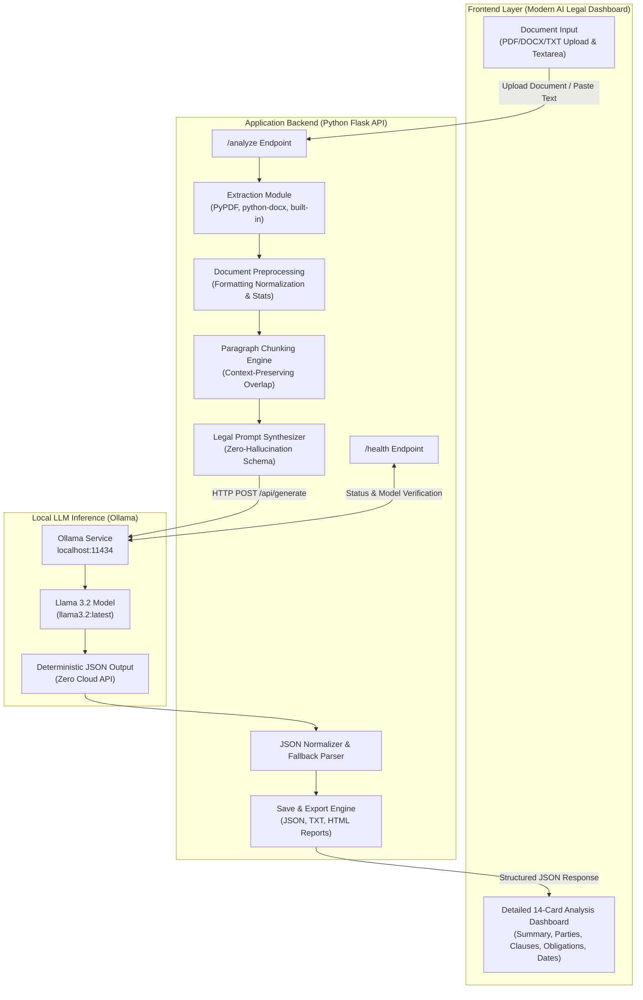

# Automated Legal Document Analyzer using GPT-4

> **Experiment 5 - Building Applications using GPT-4 / Ollama**  
> **Course Code:** 24CS2506  
> **Lab Record Register Number:** URK23CS1157  
> **Inference Engine:** Local Ollama (`llama3.2:latest`) — Zero Cloud API / No OpenAI API Key Required

---

## 1. Aim
To develop an automated legal document analyzer that accepts legal contracts or legal text, analyzes the content, generates a concise summary, identifies important clauses and obligations, and extracts relevant information such as:
- Parties involved
- Purpose of the agreement
- Key Obligations
- Rights & Intellectual Property
- Payment terms
- Duration / Term
- Termination conditions
- Confidentiality requirements
- Important dates
- Governing law
- Potentially important clauses

---

## 2. Problem Statement
Legal documents (such as Employment Agreements, Non-Disclosure Agreements, Service Agreements, and Leases) are notoriously difficult to understand due to complex legal jargon, long compound sentences, formal archaic syntax, cross-references, and dense clause structures. Manually reviewing multi-page contracts is time-consuming and prone to human oversight.

This project designs and develops an **Automated Legal Document Analyzer** powered by local LLM inference (**Llama 3.2 via Ollama**). The application ingests contracts in multiple formats (PDF, DOCX, TXT, or raw text), extracts and cleans the text, partitions lengthy documents into overlapping semantic chunks, synthesizes zero-hallucination legal prompts, and outputs a structured 14-card analysis dashboard and downloadable reports (JSON, TXT, HTML).

---

## 3. Technology Stack

| Component | Technology | Version / Specification |
|---|---|---|
| **Programming Language** | Python | 3.11.9 (or ≥ 3.11) |
| **Local LLM Engine** | Ollama | `llama3.2:latest` (or `llama3.2`) |
| **IDE** | Visual Studio Code | 1.105.1 |
| **Data Processing** | Pandas | 2.3.3 |
| **Text Embeddings & NLP** | Sentence Transformers | 5.1.1 (Optional semantic chunking) |
| **Web Backend** | Flask | 3.1.3 |
| **Document Parsers** | PyPDF / python-docx | `pypdf>=4.0.0`, `python-docx>=1.1.0` |
| **Frontend** | HTML5, CSS3, JavaScript | Modern Dark Legal AI Dashboard |
| **HTTP Client** | Requests | 2.34.2 |

---

## 4. System Architecture

The application strictly follows the system architecture and module pipeline documented in **E-RECORD 5_1157** and **EXPT 5 PREPARATION**:

### Mermaid System Architecture Diagram


### High-Level Workflow
```
Legal Document (PDF/DOCX/TXT/Manual)
         │
         ▼
    Input Module
         │
         ▼
  Extraction Module
         │
         ▼
Preprocessing Module
         │
         ▼
Section / Chunk Identification
         │
         ▼
  Prompt Module (Strict Constraints)
         │
         ▼
Local Ollama (Llama 3.2:latest)
         │
         ▼
Legal Information Extraction
 ┌──────────────┬──────────────┬──────────────┬──────────────┐
 ▼              ▼              ▼              ▼              ▼
Summary    Key Clauses    Obligations      Rights          Dates
 └──────────────┴──────────────┴──────────────┴──────────────┘
                        │
                        ▼
             Structured 14-Card Analysis
                        │
                        ▼
               Save Results (outputs/)
```

---

## 5. Module Descriptions & Responsibilities

| Module | File | Responsibility |
|---|---|---|
| **Input Module** | `templates/index.html`, `static/script.js` | Accepts legal documents (PDF, DOCX, TXT), document type hints, known parties, and analysis types (`Complete Analysis`, `Summary`, `Clause Analysis`, `Obligation Analysis`). |
| **Extraction Module** | `backend/extractor.py` | Extracts plain text from uploaded files using `pypdf` for PDFs, `python-docx` for Word documents, and resilient multi-encoding decoders for TXT files. |
| **Preprocessing Module** | `backend/preprocessing.py` | Normalizes whitespace, carriage returns, tabs, and page artifacts. Calculates document character count, word count, line count, and approximate page count. |
| **Chunking Module** | `backend/chunking.py` | Splits long contracts exceeding context limits into overlapping semantic paragraphs; merges chunk extractions into one deduplicated structured response. |
| **Prompt Module** | `backend/prompt_generator.py` | Synthesizes role-based legal prompts enforcing: *"Use ONLY information present in the document. Do not invent facts. Return 'Not specified in the document.' for missing details."* |
| **Analyzer / Ollama Module** | `backend/analyzer.py` | Connects to `http://localhost:11434`, verifies `llama3.2:latest`, executes JSON-mode inference, and contains a deterministic fallback parser if Ollama is offline. |
| **Summary Module** | `backend/analyzer.py` | Performs abstractive summarization generating legally neutral, concise executive summaries. |
| **Utils & Export Module** | `backend/utils.py` | Calculates dashboard metrics, exports structured JSON files to `outputs/`, and compiles printable TXT and HTML reports. |

---

## 6. Project Directory Structure

```
legal_document_analyzer/
│
├── app.py                     # Main Flask Application Entrypoint
├── requirements.txt           # Python dependencies (Flask, pypdf, python-docx, pandas)
├── README.md                  # Comprehensive Documentation & Architecture
├── sample_contract.txt        # Fictional Employment Agreement for Instant Testing
├── test_app.py                # Automated Test Suite (All 8 tests passing)
├── .gitignore                 # Git ignore rules
│
├── backend/
│   ├── __init__.py            # Backend package initialization
│   ├── extractor.py           # Text extraction from PDF, DOCX, TXT, manual input
│   ├── preprocessing.py       # Cleaning, whitespace normalization, text metrics
│   ├── chunking.py            # Long document paragraph chunking & result merging
│   ├── prompt_generator.py    # Zero-hallucination prompt generator with JSON schema
│   ├── analyzer.py            # Ollama Llama 3.2 API client & deterministic fallback
│   └── utils.py               # Dashboard metrics & JSON/TXT/HTML export generators
│
├── templates/
│   └── index.html             # Modern dark 14-card AI legal analysis dashboard
│
├── static/
│   ├── style.css              # Custom styling matching E-RECORD screenshots
│   └── script.js              # Client-side validation, drag-and-drop, API requests
│
├── uploads/                   # Stored uploaded temporary documents
└── outputs/                   # Auto-saved JSON legal analyses
```

---

## 7. Installation & Environment Setup

### Step 1: Clone or Navigate to the Project Directory
```bash
cd "/Users/sharuck/Documents/GPT Lab Records/GPT 4 Exp 5"
```

### Step 2: Set Up Python Virtual Environment
```bash
python3 -m venv venv
source venv/bin/activate
```

### Step 3: Install Required Dependencies
```bash
pip install -r requirements.txt
```

### Step 4: Install and Start Ollama
1. Download and install Ollama from [ollama.com](https://ollama.com).
2. Start the Ollama local background service:
   ```bash
   ollama serve
   ```
3. Pull the target model specified in the E-RECORD:
   ```bash
   ollama pull llama3.2:latest
   ```

---

## 8. Running the Application

### Start the Flask Web Server
```bash
python app.py
```
Output:
```
============================================================
 Automated Legal Document Analyzer (Experiment 5)
 Running on http://127.0.0.1:5000
 Target Model: llama3.2:latest
============================================================
```

Open your web browser and navigate to:  
👉 **`http://127.0.0.1:5000`**

---

## 9. How to Demonstrate the Project in the Lab

1. **Check Ollama Status Indicator:**  
   Notice the top-right status pill. If Ollama is running with `llama3.2:latest`, it displays a green dot: `Ollama: llama3.2:latest`. If Ollama is stopped, the application seamlessly uses the embedded deterministic legal parser and displays an informational banner.
2. **One-Click Instant Sample Test:**  
   Click the **⚡ Load Sample Employment Contract** button.  
   - Automatically populates the contract between *ABC Technologies Pvt. Ltd.* and *John Smith*.
   - Sets Document Type to `Employment Agreement`.
   - Populates known parties.
3. **Execute Analysis:**  
   Click **🔍 Analyze Legal Document**.  
   - The interactive loading screen displays progressive steps (Text extraction, prompt synthesis, local Llama 3.2 inference).
4. **Inspect the 14-Card Results Dashboard:**
   - **Metrics Strip:** Word Count (378), Character Count (2,810), Parties (2), Obligations (2), Clauses (5), Dates (1).
   - **Executive Document Summary:** Concise abstractive summary.
   - **12 Dedicated Cards:**
     1. Document Type: `Employment Agreement`
     2. Parties: `ABC Technologies Pvt. Ltd.`, `John Smith`
     3. Purpose: `Employment of John Smith as a Senior Software Engineer`
     4. Key Obligations: Confidentiality maintenance & assigned duties
     5. Rights & IP: Intellectual property ownership belongs to the company
     6. Payment Terms: `Monthly salary of ₹50,000`
     7. Duration / Term: `12 months starting from 01-07-2026`
     8. Termination: `30 days written notice`
     9. Confidentiality: Strict non-disclosure of proprietary information
     10. Important Dates: `Start Date: 01-07-2026`
     11. Governing Law: `Applicable laws of India`
     12. Potentially Important Clauses: Badges for Confidentiality, Termination, IP, Payment, Dispute Resolution.
   - **Clause Distribution & Compliance Overview:** Interactive check badges showing identified vs not found clauses.
5. **Demonstrate Exports:**
   - Click **View Raw JSON** to view the strictly structured JSON modal.
   - Click **Copy JSON** to copy to clipboard.
   - Click **TXT Report** to download a clean text report.
   - Click **HTML Report** to download or print a formatted client report.
6. **Upload Custom Documents:**  
   Switch to the Upload tab and drop any PDF, DOCX, or TXT contract to demonstrate real-time text extraction and analysis.

---

## 10. Sample Test Data (`sample_contract.txt`)

```text
EMPLOYMENT AGREEMENT

This Employment Agreement is entered into on 01-07-2026, by and between:
1. ABC Technologies Pvt. Ltd., Tech Park, Bangalore, India (Employer).
AND
2. Mr. John Smith, 123 Elm Street, Bangalore, India (Employee).

1. PURPOSE: Employment of John Smith as a Senior Software Engineer.
2. DURATION / TERM: 12 months, commencing from 01-07-2026.
3. KEY OBLIGATIONS:
   (a) Perform assigned duties diligently and follow company policies.
   (b) Maintain strict confidentiality regarding company trade secrets.
4. RIGHTS & IP: All IP created during employment belongs to ABC Technologies Pvt. Ltd.
5. PAYMENT TERMS: Monthly salary of ₹50,000 via bank transfer.
6. TERMINATION: 30 days written notice by either party.
7. CONFIDENTIALITY: Strictly prohibited from disclosing proprietary data.
8. GOVERNING LAW: Applicable laws of India.
```

---

## 11. Expected Structured JSON Output

```json
{
  "document_type": "Employment Agreement",
  "parties": [
    "ABC Technologies Pvt. Ltd.",
    "John Smith"
  ],
  "purpose": "To outline the terms and conditions of employment for John Smith as a Senior Software Engineer with ABC Technologies Pvt. Ltd.",
  "duration": "12 months starting from 01-07-2026",
  "obligations": [
    "The Employee shall perform all assigned duties diligently, efficiently, and in compliance with company policies.",
    "The Employee must maintain strict confidentiality regarding all company trade secrets, source code, and client records."
  ],
  "rights": [
    "Any intellectual property created during employment belongs solely and exclusively to ABC Technologies Pvt. Ltd."
  ],
  "payment_terms": "Monthly salary of ₹50,000",
  "termination": "Either party may terminate by providing 30 days written notice.",
  "confidentiality": "Employee must maintain strict confidentiality regarding company proprietary information.",
  "important_dates": [
    "Start Date: 01-07-2026"
  ],
  "governing_law": "Applicable laws of India",
  "key_clauses": [
    "Confidentiality",
    "Termination",
    "Intellectual Property",
    "Payment Terms",
    "Dispute Resolution"
  ],
  "summary": "An employment agreement outlining the terms and conditions for John Smith's employment with ABC Technologies Pvt. Ltd. The contract specifies a 12-month duration starting 01-07-2026, monthly compensation of ₹50,000, 30 days written notice for termination, and strict confidentiality obligations.",
  "inference_engine": "Local Ollama (llama3.2:latest)"
}
```

---

## 12. Automated Verification & Testing

An automated test suite is included in `test_app.py`. To run the tests:
```bash
python test_app.py
```
Result:
```
Ran 8 tests in 0.103s
OK
```
Tests cover:
- Text extraction from files and strings
- Text preprocessing and statistics generation
- Short document vs long document chunking
- Zero-hallucination prompt generation
- Deterministic fallback analysis
- Safe JSON extraction from raw model output
- Dashboard metrics calculation
- Flask endpoints (`/health`, `/sample`, `/analyze`, `/download/txt`, `/download/html`, `/download/json`)

---

## 13. Privacy & Security

- **100% Local Inference:** No document text or metadata is sent to any external cloud API (OpenAI, Anthropic, Google Cloud).
- **Zero API Key Requirement:** Operates offline using local Ollama.
- **Data Minimization:** Uploaded documents are saved temporarily for extraction and are not retained in public directories.

---

## 14. Legal Disclaimer

> **DISCLAIMER:**  
> This application provides automated legal document analysis for educational and informational purposes only. It is not legal advice and should not replace consultation with a qualified legal professional or attorney.
